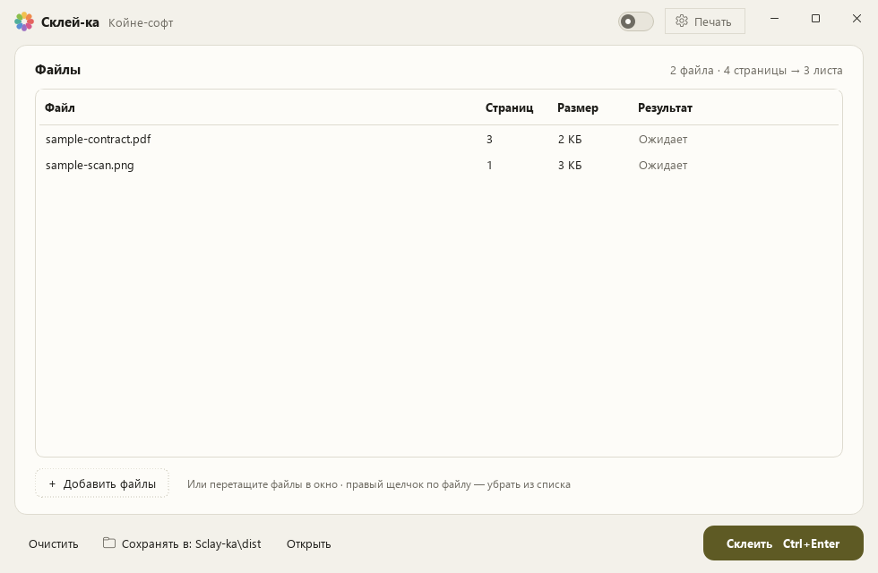

# Sclayka (Склей-ка)

Sclayka is a small Windows utility for office staff who regularly scan passports and ID cards. It fits two scanned pages onto one A4 sheet to save paper and compresses the resulting PDF to save storage space.

Place the passport or ID near the top of the scanner bed. Sclayka crops the top half of each scanned page and stacks the crops in pairs on portrait A4 sheets. Each input file produces its own PDF, even when several files are processed in one batch.



## Features

- Drag and drop PDFs, images, or a folder of scans.
- Choose a quality preset to balance readability and file size. Grayscale is optional.
- Track progress or cancel a batch while processing runs in a background thread.
- Choose where the PDFs are saved. When a filename already exists, Sclayka adds a numbered suffix.
- Process documents locally with an English or Russian interface and light and dark themes.

Choose **English** or **Русский** the first time you open the app. To change it later, open the gear menu, select **Language**, and reopen Sclayka.

## Windows download

Packaged versions are listed on [GitHub Releases](https://github.com/funta365/sclay-ka/releases). The installer offers both English and Russian.

## Run from source

On Windows with Python 3.14, run these commands from the project folder in PowerShell.

```powershell
python -m venv .venv
.\.venv\Scripts\python.exe -m pip install -r requirements.txt
.\.venv\Scripts\python.exe sclayka.py
```

Add your scans, choose an output folder, and click **Merge** (**Склеить** in Russian). Supported inputs include PDF, JPG, PNG, TIFF, and BMP. A file with an odd number of pages leaves the bottom half of its last output sheet blank.

## Build for Windows

Install PyInstaller in the same virtual environment.

```powershell
.\.venv\Scripts\python.exe -m pip install pyinstaller
.\build.bat
```

The portable build is written to `dist/Sclayka.exe`. To build the Windows installer, install Inno Setup 6 and run `.\build_installer.bat`. The installer version is set in `installer.iss`.

## License

Sclayka is licensed under the [GNU Affero General Public License, version 3](LICENSE).
The [third-party notices](THIRD_PARTY_NOTICES.md) list the components shipped in the Windows installer, their licenses, and where to get the matching source code.

## Source layout

| File | Role |
| --- | --- |
| `sclayka.py` | PySide6 interface, batch queue, and progress reporting |
| `sclayka_core.py` | PDF and image processing with PyMuPDF and Pillow |
| `build.bat`, `build_installer.bat`, `installer.iss` | Windows packaging |
